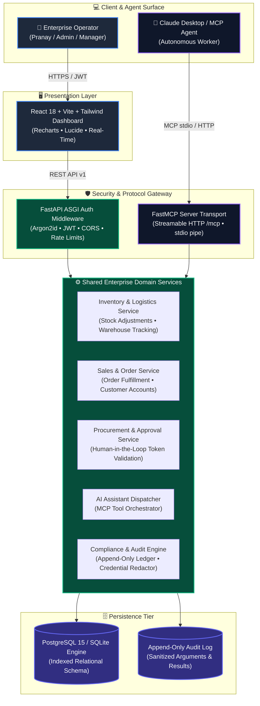

<div align="center">

  

  <p align="center">
    <a href="https://readme-typing-svg.demolab.com">
      
    </a>
  </p>

  <p align="center">
    <a href="#-ci--build-status"></a>
    <a href="#-automated-testing"></a>
    <a href="#-technology-stack"></a>
    <a href="#-technology-stack"></a>
    <a href="#-technology-stack"></a>
    <a href="#-technology-stack"></a>
    <a href="#-license--attribution"></a>
  </p>

  <p align="center">
    <b>An enterprise-grade platform uniting traditional ERP operations with autonomous AI workflows through the Model Context Protocol (MCP), protected by strict human-in-the-loop cryptographic approval guardrails.</b>
  </p>

  <p align="center">
    <a href="#-platform-walkthrough--live-demo">Demo Video</a> •
    <a href="#-quick-start">Quick Start</a> •
    <a href="#-architecture-overview">Architecture</a> •
    <a href="#-application-modules">Modules</a> •
    <a href="#-mcp-integration--claude-desktop">MCP Setup</a> •
    <a href="#-rest-api-reference">API Docs</a> •
    <a href="#-security-architecture">Security</a> •
    <a href="#-license--attribution">Attribution</a>
  </p>

</div>

---

## 🎬 Platform Walkthrough & Live Demo

<div align="center">
  <video src="https://github.com/pranaygandlewar/WORKNEX-AI/raw/main/docs/assets/Demo.mp4" controls="controls" width="100%" style="max-width: 900px; border-radius: 12px; border: 1px solid #334155; box-shadow: 0 10px 30px rgba(0,0,0,0.5);">
    Your browser does not support the video tag.
  </video>

  <p align="center">
    <a href="https://github.com/pranaygandlewar/WORKNEX-AI/raw/main/docs/assets/Demo.mp4">
      
    </a>
    <a href="https://raw.githubusercontent.com/pranaygandlewar/WORKNEX-AI/main/docs/assets/Demo.mp4">
      
    </a>
  </p>
  <p><sub><i>Full HD platform demonstration showcasing the AI assistant, multi-warehouse inventory tracking, procurement approvals, and real-time operations dashboard.</i></sub></p>
</div>

---

## 📌 Executive Summary

**WORKNEX AI** transforms modern business resource management by embedding an intelligent **Model Context Protocol (MCP)** AI assistant directly into enterprise inventory, logistics, sales, and procurement pipelines. 

While autonomous AI agents can analyze inventory deficits and propose replenishment actions, **all consequential operations remain guarded by human-in-the-loop authorization**—enforcing server-generated cryptographic approval tokens that agents cannot forge, leak, or self-approve.

```
┌─────────────────────────────────────────────────────────────────────────────┐
│                            WORKNEX AI PLATFORM                              │
├───────────────────────────────┬─────────────────────────────────────────────┤
│  🎯 Core ERP Capabilities     │  Multi-Warehouse Inventory • Sales Orders   │
│                               │  Procurement Cycles • Customer Management   │
├───────────────────────────────┼─────────────────────────────────────────────┤
│  🤖 Agentic AI Layer (MCP)    │  Model Context Protocol Tools • FastMCP     │
│                               │  Real-Time Reasoning • Telemetry Queries    │
├───────────────────────────────┼─────────────────────────────────────────────┤
│  🛡️ Human-in-the-Loop Trust   │  Cryptographic Approval Tokens (SHA-256)    │
│                               │  Constant-Time Equality Checks • RBAC       │
├───────────────────────────────┼─────────────────────────────────────────────┤
│  📜 Compliance & Audit        │  Append-Only Immutable Ledger               │
│                               │  Automated Credential & Token Redaction     │
└───────────────────────────────┴─────────────────────────────────────────────┘
```

---

## 🏗️ Architecture Overview

WORKNEX AI uses a unified domain services layer shared equally by the **FastAPI REST API** and the **FastMCP Protocol Server**, eliminating duplicated business logic.



---

## ⚡ Quick Start

### 🚀 One-Click Windows Launchers (Recommended)
WORKNEX AI includes automated single-command launchers that configure, seed, and run the backend and frontend simultaneously:

```powershell
# Option A: Batch script (Command Prompt or double-click from Explorer)
.\start-dev.bat

# Option B: PowerShell script
.\start-dev.ps1
```

---

### 🐳 Docker Compose Deployment
Spin up PostgreSQL 15, the FastAPI Backend, and the React Frontend with a single command:

```bash
# 1. Clone & copy environment configuration
cp .env.example .env

# 2. Start all services
docker compose up --build
```

| Service | Endpoint | Description |
| :--- | :--- | :--- |
| **Frontend UI** | [http://localhost:5173](http://localhost:5173) | Responsive React Dashboard |
| **Backend REST API** | [http://localhost:8000](http://localhost:8000) | FastAPI Core Engine |
| **Interactive API Docs** | [http://localhost:8000/docs](http://localhost:8000/docs) | Swagger OpenAPI UI |
| **MCP Server Transport** | [http://localhost:8000/mcp](http://localhost:8000/mcp) | Streamable HTTP Transport |
| **PostgreSQL Database** | `localhost:15432` | Managed Relational Database |

---

### 💻 Manual Local Development Setup

#### 1. Backend Setup (Python 3.13+)
```bash
# Install dependencies with Astral uv
uv sync

# Seed demonstration database (worknex.db)
uv run python main.py seed

# Start FastAPI server on port 8000
uv run python main.py server
```

#### 2. Frontend Setup (Node.js 20+)
```bash
cd frontend

# Install packages
npm install

# Start Vite development server
npm run dev
```

---

## 🔑 Demonstration Accounts

The database comes pre-seeded with enterprise accounts spanning the entire RBAC permission matrix:

| Username | Password | Role | System Permissions |
| :--- | :--- | :--- | :--- |
| **`Pranay`** | `Pranay1234` | **Administrator** | Full configuration, stock adjustments, procurement approvals, user & audit management |
| **`admin`** | `Admin@Worknex2026!` | **Administrator** | Complete administrative and approval access |
| **`manager`** | `Manager@Worknex2026!` | **Manager** | Operational dashboard, stock reconciliations, requisition reviews and approvals |
| **`employee`** | `Employee@Worknex2026!` | **Employee** | Catalog search, order visibility, requisition proposals |

> **Note:** User identification is case-insensitive (e.g., `Pranay`, `pranay`, `PRANAY`).

---

## 📦 Application Modules

<details open>
<summary><b>1. 📊 Executive Overview Dashboard</b></summary>
<br/>

- **Real-Time KPI Summaries**: Total sales orders, open orders pending fulfillment, live inventory valuation, low-stock threshold triggers, and pending procurement requests.
- **Interactive Visualizations (Recharts)**:
  - **Monthly Sales Pipeline Area Chart**: Revenue velocity and trajectory over time.
  - **Order Status Mix Pie Chart**: Breakdown of open, processing, completed, and closed orders.
  - **Warehouse Unit Distribution Bar Chart**: Stock capacity distribution across regional facilities.
- **Live Business Activity Stream**: Real-time chronological audit trail of human and AI actions.
</details>

<details open>
<summary><b>2. 🏭 Multi-Warehouse Inventory Management</b></summary>
<br/>

- **Multi-Facility Logistics**: Stock tracking across `WH-North` (New York), `WH-South` (Atlanta), `WH-East` (Boston), and `WH-West` (San Francisco).
- **Automated Threshold Triggers**: Highlights materials that fall below safety reorder points.
- **Authorized Stock Reconciliations**: Controlled quantity adjustments with mandatory reason documentation.
- **Negative Stock Prevention**: Server-side validation guarantees stock cannot be adjusted below zero.
- **Movement Traceability**: Complete chronological audit log of all manual and automated adjustments.
</details>

<details open>
<summary><b>3. 🛒 Sales & Order Management</b></summary>
<br/>

- **Order Lifecycle Management**: Full tracking through `open`, `processing`, `closed`, and `cancelled` states.
- **Customer Account Linking**: Customer identifiers, addresses, and order value aggregation.
- **Order Creation & Updates**: Managerial controls to register new sales orders and update statuses.
</details>

<details open>
<summary><b>4. 📋 Procurement & Human-in-the-Loop Approvals</b></summary>
<br/>

- **Two-Phase Requisition Flow**:
  1. Staff or AI agents propose a purchase requisition (`status: pending_approval`).
  2. The server records the requisition and generates a cryptographic token (`secrets.token_urlsafe(16)`).
  3. The token is **strictly omitted** from applicant and AI tool responses.
  4. An authorized Manager/Administrator reviews the requisition and executes the approval.
  5. The approval executes a constant-time check (`secrets.compare_digest`), registers the approving manager, and replenishes inventory.
- **Duplicate Approval Prevention**: Guards against replay approvals or approving rejected requests.
</details>

<details open>
<summary><b>5. 🤖 AI Business Assistant (MCP Integrated)</b></summary>
<br/>

- **Natural Language Operations Interface**:
  - *"Show all low-stock products."*
  - *"Which warehouse has the lowest inventory?"*
  - *"Summarize open sales orders."*
  - *"Create a purchase requisition for MAT-002 with 100 units."*
- **MCP Tool Invocation Badges**: Real-time UI cards rendering tool signatures, input arguments, and live database responses.
- **Hard AI Safety Guardrail**: AI agents can propose purchase requisitions, but **cannot approve them**. The assistant informs the user that a managerial review is required.
</details>

<details open>
<summary><b>6. 📜 Compliance & Audit Center</b></summary>
<br/>

- **Immutable Append-Only Ledger**: Logs every human action and MCP tool invocation with timestamps, actors, and outcomes.
- **Automated Credential Redaction**: Automatically sanitizes sensitive parameters (`approval_token`, `password`, `api_key`, `secret`) to prevent credential leakage.
- **Detailed Inspection Drawer**: View serialized arguments and execution results.
</details>

<details open>
<summary><b>7. 👥 User & Access Management (RBAC)</b></summary>
<br/>

- **Role-Based Permissions**: Distinct permission boundaries for `Administrator`, `Manager`, `Employee`, and `AI Agent`.
- **Argon2id Password Hashing**: Uses `argon2-cffi` with memory-hard parameters.
- **Account Provisioning**: Administrator interface to create accounts, assign roles, and modify access.
</details>

<details open>
<summary><b>8. ⚙️ System Settings & Telemetry</b></summary>
<br/>

- **Infrastructure Readiness**: Live health status for the PostgreSQL database, FastMCP server, and AI engine.
- **MCP Server Metadata**: Streamable HTTP binding coordinates, ASGI authentication settings, and stdio transport parameters.
</details>

---

## 🔌 MCP Integration & Claude Desktop

WORKNEX AI functions as a first-class Model Context Protocol (MCP) server.

### FastMCP Tool Registry

| Tool Signature | Type | Description |
| :--- | :--- | :--- |
| `get_open_orders(status="open", limit=20)` | **Read** | Retrieves sales orders filtered by status. |
| `check_inventory(material_id)` | **Read** | Checks stock balance and reorder threshold for a material. |
| `get_low_stock_items()` | **Read** | Identifies all materials below their reorder threshold. |
| `create_requisition(material_id, quantity, requested_by)` | **Write (Guarded)** | Creates a purchase requisition in `pending_approval` state. |
| `approve_pending_requisition(requisition_id, approved_by, approval_token)` | **Write (Privileged)** | Approves a pending requisition using constant-time token verification. |

### Claude Desktop Configuration
Add WORKNEX AI to your `claude_desktop_config.json`:

```json
{
  "mcpServers": {
    "worknex-ai": {
      "command": "uv",
      "args": [
        "run",
        "--directory",
        "D:\\CLG Projects\\WORKNEX AI",
        "python",
        "-m",
        "src.server"
      ],
      "env": {
        "DATABASE_URL": "sqlite:///./worknex.db"
      }
    }
  }
}
```

---

## 🌐 REST API Reference

All endpoints are versioned under `/api/v1` and protected with JWT bearer authentication.

| Method | Route | Access | Function |
| :---: | :--- | :--- | :--- |
| `POST` | `/api/v1/auth/login` | Public | Authenticates credentials and returns JWT token |
| `GET` | `/api/v1/auth/me` | Authenticated | Retrieves profile of currently authenticated user |
| `GET` | `/api/v1/dashboard/overview` | Authenticated | Returns real-time metrics, KPI cards, and charts |
| `GET` | `/api/v1/inventory` | Authenticated | Lists items with search, warehouse, and low-stock filters |
| `POST` | `/api/v1/inventory` | Manager/Admin | Registers a new material in the catalog |
| `POST` | `/api/v1/inventory/{id}/adjust` | Manager/Admin | Performs authorized stock adjustment (rejects negative stock) |
| `GET` | `/api/v1/inventory/movements` | Authenticated | Retrieves chronological inventory movement trail |
| `GET` | `/api/v1/orders` | Authenticated | Lists sales orders with status filtering |
| `POST` | `/api/v1/orders` | Manager/Admin | Creates a new sales order |
| `GET` | `/api/v1/requisitions` | Authenticated | Lists requisitions (approval tokens redacted for non-managers) |
| `POST` | `/api/v1/requisitions` | Authenticated | Proposes purchase requisition in `pending_approval` state |
| `POST` | `/api/v1/requisitions/{id}/approve` | Manager/Admin | Approves requisition and updates inventory stock |
| `POST` | `/api/v1/requisitions/{id}/reject` | Manager/Admin | Rejects requisition with reason documentation |
| `POST` | `/api/v1/ai/chat` | Authenticated | Interacts with AI assistant & invokes MCP tool registry |
| `GET` | `/api/v1/audit` | Manager/Admin | Inspects append-only compliance audit trail |
| `GET` | `/api/v1/users` | Administrator | Lists all enterprise user accounts |
| `GET` | `/api/v1/system/health` | Public | Returns database, MCP, and platform health telemetry |

---

## 🔒 Security Architecture

```
┌─────────────────────────────────────────────────────────────────────────────┐
│                       MULTI-TIER DEFENSE IN DEPTH                           │
├─────────────────────────────────────────────────────────────────────────────┤
│  1. Password Hashing: Argon2id with memory-cost & parallelism hardening.    │
│  2. Token Comparison: secrets.compare_digest prevents side-channel timing.  │
│  3. Token Masking: Approval tokens are never returned to AI agent tools.    │
│  4. Audit Sanitization: Automatic regex/key redaction of sensitive data.   │
│  5. Transport Security: Pure ASGI middleware enforcing MCP_API_KEY.        │
│  6. Database Constraints: Negative quantity prevention & foreign keys.     │
└─────────────────────────────────────────────────────────────────────────────┘
```

---

## 🧪 Automated Testing

WORKNEX AI maintains an automated test suite with **36 passing tests and 0 failures**:

```bash
uv run pytest -v
```

```
tests/test_tools.py ..................               [ 50%] (18 Original Tests Passed)
tests/test_transport_auth.py .......                 [ 69%] (7 Original Tests Passed)
tests/test_worknex_api.py ...........                [100%] (11 New Tests Passed)

======================= 36 passed, 2 warnings in 13.01s =======================
```

- **Original MCP Baseline (25 tests)**: 100% preserved. Verifies inventory queries, requisition lifecycles, and ASGI transport security.
- **WORKNEX AI Test Suite (11 tests)**: Covers Argon2 password hashing, RBAC permissions, stock adjustment boundaries, token masking, duplicate approval rejection, audit redaction, and AI tool orchestration.

---

## 📜 License & Attribution

### Attribution Notice
WORKNEX AI is an enterprise extension built upon the foundational MCP server architecture created by **Joseph Kamau** ([@josephkamau32](https://github.com/josephkamau32)).

- **Original Project**: *ERP-lite MCP Server*
- **Original Repository**: [josephkamau32/erp-lite-mcp](https://github.com/josephkamau32/erp-lite-mcp)
- **Original Copyright**: Copyright (c) 2026 josephkamau32

### License
This project is licensed under the **MIT License**. See the [LICENSE](LICENSE) file for complete details.

---

<div align="center">
  <sub>Built with ❤️ for advanced enterprise operations, AI/ML engineering, and Model Context Protocol excellence.</sub>
</div>
