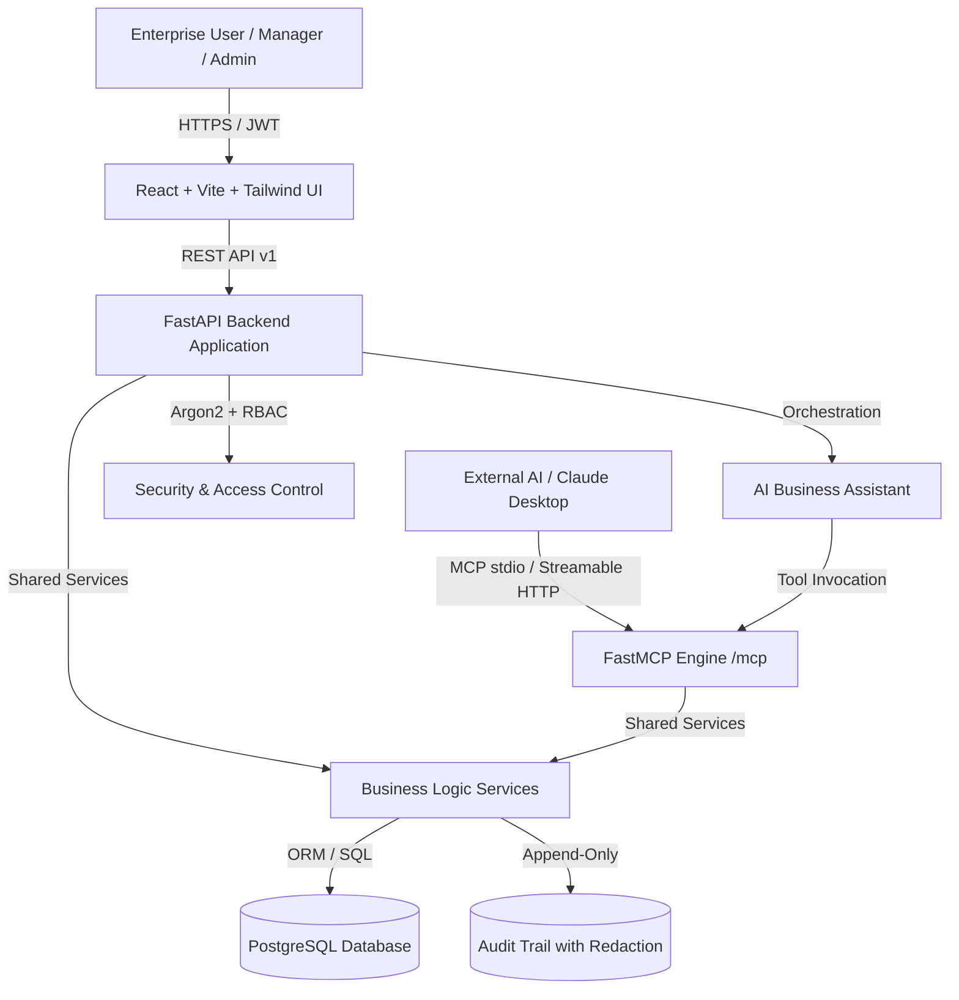

# WORKNEX AI — System Architecture

WORKNEX AI is an intelligent enterprise management platform that seamlessly unifies ERP core operations with the Model Context Protocol (MCP) and autonomous AI workflows, while enforcing rigorous human-in-the-loop approval security boundaries.

## 1. High-Level Architecture Diagram

## 2. Core Architectural Pillars

### 2.1 Shared Business Layer

Both the REST API (used by human operators via the React dashboard) and the MCP Server (used by AI agents) invoke identical business services in `backend/app/services/`. This guarantees:

- Zero duplication of domain logic.
- Consistent validation rules (e.g., negative stock prevention).
- Universal audit trail generation.

### 2.2 Dual-Layer Security & Human-in-the-Loop Workflow

- **Authentication**: Argon2id password hashing + JWT access tokens for human operators; ASGI middleware verifying `MCP_API_KEY` for streamable HTTP MCP transport; `ADMIN_API_KEY` for administrative operations.
- **Role-Based Access Control (RBAC)**: Enforced server-side across all endpoints:
  - `Administrator`: Full system configuration, user management, audit access.
  - `Manager`: Dashboard, stock adjustments, procurement review and approvals.
  - `Employee`: Read-only access to catalog/orders, requisition submission.
  - `AI Agent`: Explicitly permitted MCP tool access without self-approval permissions.
- **Human-in-the-Loop Approvals**:
  1. AI Agent or employee creates a purchase requisition via `create_requisition`.
  2. The server records the record with status `pending_approval` and generates a cryptographic token.
  3. The token is **never** leaked to the AI agent or applicant.
  4. Only an authorized human manager can view the token or approve the requisition.
  5. The approval executes in constant-time comparison (`secrets.compare_digest`), preventing timing attacks.

### 2.3 Compliance-Grade Audit Trail

- Every write or read action across both REST and MCP surfaces writes an append-only entry to `audit_log`.
- Sensitive argument parameters (`approval_token`, `password`, `api_key`, `secret`) are systematically sanitized and redacted before persistence.
